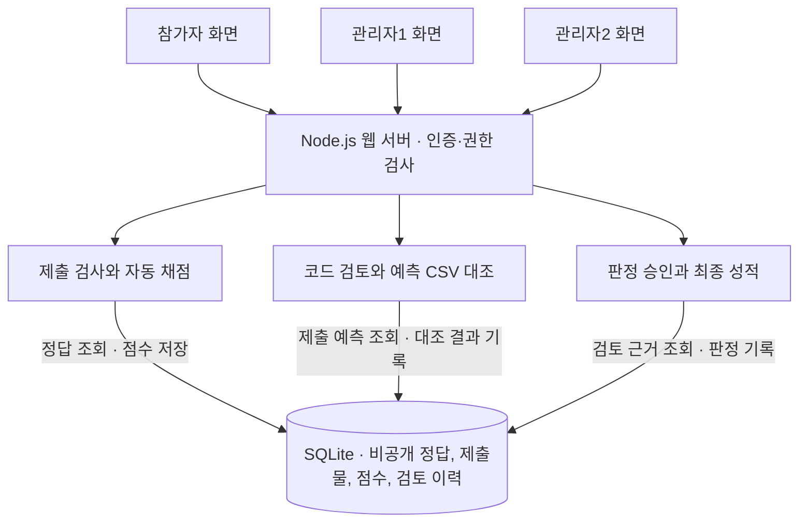

# AI 모델 성능평가 경진대회
SCH Univ 플랫폼 개발대회

## 발표 자료

**ScoreLab · 예측 CSV가 최종 성적이 되기까지**

[프로세스 상세 설명](#제출-한-건이-최종-성적이-되기까지) · [시스템 아키텍처](#아키텍처) · [시연 영상](#시연-영상) · [한계와 향후 계획](#한계와-향후-계획)

### 1. 어떤 시스템인가요?

ScoreLab은 AI 모델의 예측을 자동 채점하고, 관리자가 제출 근거를 검토해 최종 성적을 확정하는 웹 서비스입니다.

### 2. 참가자가 파일을 제출합니다

참가자는 정답을 제외한 평가 데이터를 받아 예측합니다. **예측 CSV, Notebook, 모델 가중치**를 제출하면 서버가 파일 형식과 CSV의 행 ID를 확인합니다.

### 3. 서버가 공식 점수를 계산합니다

서버가 행 ID별로 예측값과 비공개 정답을 비교합니다. 시연에 사용한 Kaggle 설비 고장 분류 예제에서는 **2,000건 중 1,992건 정답**으로 **0.996점**이 나왔습니다.

### 4. 관리자1이 예측의 근거를 검토합니다

관리자1은 추론 코드와 로그, 가중치 파일을 봅니다. 재생성한 CSV가 있으면 제출본과 대조해 **일치 건수와 불일치 행 ID**를 기록하고, 검토 의견과 판정을 제안합니다.

### 5. 관리자2가 최종 판정을 내립니다

관리자2는 제안과 근거를 확인합니다. 적합을 승인하면 대표 기록을 확정하고, 부적합을 승인하면 같은 참가자의 다음 기록을 검토합니다. 근거가 더 필요하면 재검토를 요청할 수 있습니다.

### 아키텍처



참가자 화면은 정답을 제외한 특성과 익명 순위를 받습니다. 채점 모듈은 제출 예측을 비공개 정답과 대조하고, 검토 모듈은 제출 예측과 재생성 예측만 비교합니다. 두 결과는 관리자2의 승인 화면에 표시됩니다.

### 한계와 향후 계획

| 현재 한계 | 향후 계획 |
|---|---|
| 검토자가 재생성 CSV를 직접 올립니다. 전체 예측값이 일치해도 어떤 코드와 가중치로 만들었는지는 따로 확인해야 합니다. | 실행 환경과 가중치 버전을 검토 기록에 남기고, 별도의 격리 환경에서 예측을 재생성하는 방식을 검토합니다. |
| 시연 점수는 Kaggle 합성 데이터의 고정 평가셋에서 얻은 결과입니다. | 실제 설비 데이터와 이후 시점의 데이터로 고장 탐지율과 오경보를 확인합니다. |
| 현재 데모는 한 대의 서버에서 실행합니다. | 마감 직전 동시 제출과 업로드 중단 상황을 재현해 처리 시간과 복구 동작을 확인합니다. |

---

## 어떻게 만들었나요?

ScoreLab은 경진대회 참가자의 예측 결과를 같은 기준으로 채점하고, 운영자가 제출 코드를 검토해 최종 성적을 확정하는 웹 서비스입니다.

Node.js로 제출·채점·검토 화면을 연결하고, SQLite에 제출 파일과 점수, 판정 이력을 저장했습니다.

참가자가 예측 CSV, Notebook, 모델 가중치를 올리면 서버가 파일 형식과 행 ID를 검사합니다. 검사를 통과하면 ID별 예측값을 비공개 정답과 비교해 점수를 계산하고 익명 리더보드에 반영합니다.

관리자1은 최고점 제출의 코드와 로그를 살핍니다. 예측을 재생성한 파일이 있으면 제출본과 대조해 일치 건수와 차이가 난 행 ID를 검토 근거로 남깁니다.

관리자2는 제안과 대조 근거를 확인해 승인하거나 재검토를 요청합니다. 적합 승인 시 대표 기록을 확정하고, 부적합 승인 시 같은 참가자의 다음 기록을 검토합니다.

## 어떤 Kaggle 데이터를 사용했나요?

설비의 고장 여부를 구분하는 **Machine Predictive Maintenance Classification**을 시연 과제로 사용했습니다.

산업 설비를 모사한 합성 데이터 10,000건으로, 각 행에는 제품 등급, 대기·공정 온도, 회전수, 토크, 공구 마모 시간이 들어 있습니다.

Python으로 8,000건에서 결정트리를 학습하고, 따로 남겨 둔 2,000건의 예측을 CSV로 만들어 ScoreLab에 제출했습니다. [Kaggle 데이터셋](https://www.kaggle.com/datasets/shivamb/machine-predictive-maintenance-classification)

## 시연 영상

[ScoreLab 시연 영상 보기 (MP4)](docs/scorelab-demo.mp4)

## 실행과 역할별 확인

Node.js 24와 Python 3를 사용합니다. 별도 패키지 설치는 필요 없습니다. [Kaggle Input](https://www.kaggle.com/datasets/shivamb/machine-predictive-maintenance-classification)에서 `predictive_maintenance.csv`를 내려받은 뒤 아래처럼 파일 위치를 지정하세요.

```bash
git clone https://github.com/wjdekgur02/ai-.git scorelab
cd scorelab
npm run demo -- "$HOME/Downloads/predictive_maintenance.csv"
```

브라우저에서 http://127.0.0.1:8080 을 엽니다. 아래 계정의 공통 로컬 시연 비밀번호는 `ScoreLab-demo-2026!`입니다. 회원가입으로 시작하려면 참여 코드 `SCORELAB-DEMO`를 사용하세요.

| 로그인 이메일 | 확인할 기능 |
|---|---|
| dahyeok@scorelab.test | **산업 설비 고장 분류**에서 예측 CSV, Notebook, 가중치를 제출하고 점수와 남은 횟수 확인 |
| reviewer@scorelab.test | **검토 연습**의 최고점 기록에서 Notebook 원문·로그 검토, 재생성 CSV 대조, 적합·부적합 판정 제안 |
| admin@scorelab.test | 같은 기록에서 근거를 확인하고 제안 승인 또는 재검토 요청 |

참가자가 업로드할 세 파일은 `.demo-data/maintenance/samples/` 안의 `prediction.csv`, `notebook.ipynb`, `model.safetensors`입니다. 서버는 참가자에게 정답을 제거한 특성 CSV와 제출 양식을 제공합니다. 관리자용 정답은 samples 밖에 저장합니다.

첫 회차는 3회, 둘째 회차는 2회까지 채점합니다. 검토 연습은 이미 마감된 별도 프로젝트입니다.

## Kaggle 데이터와 실제 채점

Kaggle의 **Machine Predictive Maintenance Classification**은 산업 설비를 모사한 AI4I 2020 합성 데이터입니다. 원 저자는 Stephan Matzka입니다. 이 실험은 현재 관측의 고장 여부(Target)를 분류합니다. 고장이 발생하기까지 남은 시간을 예측하는 과제와 구분됩니다. [Kaggle 배포 페이지](https://www.kaggle.com/datasets/shivamb/machine-predictive-maintenance-classification) · [UCI 원본 및 라이선스](https://doi.org/10.24432/C5HS5C) · [실험에서 읽은 Kaggle CSV 공개 사본](https://github.com/ayush-agarwal-0502/Machine-Predictive-Maintainence-Anomaly-Detection/blob/main/predictive_maintenance.csv)

10,000건을 고장 비율을 유지하며 **학습 8,000건, 평가 2,000건**으로 분리했습니다(시드 42).

제품 등급·대기 온도·공정 온도·회전수·토크·마모 시간을 사용하고 온도차, 기계적 출력, 마모×토크를 계산합니다. Failure Type, 제품 ID, 행 ID, Target은 모델 입력에서 제외했습니다. UDI는 제출 행 매칭에만 사용합니다.

학습셋 내부 검증(시드 43)에서 고장 클래스 F1으로 트리 깊이와 최소 잎 크기를 선택했습니다. 선택값은 깊이 8, 최소 8건입니다. 최종 평가셋은 이 선택에 사용하지 않았습니다.

| 평가 2,000건 | Accuracy | 고장 재현율 | 고장 F1 |
|---|---:|---:|---:|
| 전부 정상으로 예측 | 96.60% | 0.00% | 0.00% |
| 학습한 결정트리 | **99.60%** | **88.24%** | **93.75%** |

실제 정상 1,932건을 모두 정상으로 판정했습니다. 실제 고장 68건 중 60건을 찾고 8건을 놓쳤습니다. 정상 설비에 대한 오경보는 0건입니다.

이 수치는 고정된 분할의 합성 데이터 결과입니다. 실제 공장이나 미래 시점에 대한 성능은 별도 검증이 필요합니다.

Notebook을 samples 폴더에서 실행하면 train.csv로 학습하고 모델 파일을 다시 읽어 features.csv의 예측 결과를 생성합니다. 공식 지표는 Accuracy이며 고장 재현율과 F1은 해석을 위한 보조 지표입니다.

## RFP 구현 범위

| RFP | 웹에서 확인할 정책 |
|---|---|
| 3쪽 · 역할과 참여 | 참여 코드 필수 가입 및 추가 대회 등록, 담당 대회 관리자1의 회원 관리, 관리자2의 대회 개설 및 초대 |
| 4~5쪽 · 접수와 채점 | 필수 세 파일 내용 검사, 회차별 마감과 횟수, 마감 전 전송 시작 인정, 마감 후 접수만 허용, 실패 미차감 |
| 6쪽 · 순위와 성적 | 참가자 가명/담당 관리자 실명, 최고점과 공동 순위, 동점 최신 제출 우선 검토, 부적합 승인 뒤 차순위 후보 검토 |
| 7~8쪽 · 검토와 보안 | 대회별 접근 제어, 감사 기록, Notebook 원문과 로그 표시, 재생성 CSV 대조, 동일 예측 기록 수 제공, 서로 다른 계정의 제안과 승인 |

### 점수가 계산되는 과정

1. 관리자2가 ID, 정답 열, 지표, 허용 레이블, 기간별 제출 한도를 지정합니다. 공개용 CSV를 만들 때 정답 열을 제거합니다.
2. 예제 Notebook은 학습한 분류 트리를 파일에 저장하고 다시 읽어 설비 관측별 고장 예측을 CSV에 씁니다. 예제에는 Python 표준 라이브러리만 필요합니다. Jupyter에서 예제 디렉터리의 Notebook을 열고 셀을 순서대로 실행하면 재생성할 수 있습니다.
3. 서버는 파일 내부 구조, 헤더·행 수·ID·허용 레이블을 검사합니다. ID 순서로 정렬해 정답 일치 개수를 전체 개수로 나눕니다. Accuracy, Macro F1, MAE, RMSE를 지원합니다. Macro F1은 등록된 클래스별 F1의 단순 평균이며 분모가 0인 클래스는 0점입니다.
4. 채점 성공만 횟수에서 차감합니다. 마감 전 첫 데이터가 도착하면 마감 후 완료해도 채점하며 업로드 처리 제한은 120초입니다. 마감된 회차의 신규 제출은 파일 접수만 합니다.
5. 참가자끼리는 가명, 관리자에게는 실명이 표시됩니다. 같은 참가자의 최고점 동점은 최근 수신 완료 순, 참가자 간 동점은 공동 순위입니다. 최고점에 부적합 제안이 있어도 관리자2 승인 전까지 순위를 유지합니다. 승인 후 다음 후보를 검토합니다. 판정 제안자와 승인자는 서로 다른 계정이어야 합니다.

## 제출 한 건이 최종 성적이 되기까지

**자동 채점**은 제출한 예측 CSV를 비공개 정답과 비교해 점수를 계산합니다. **코드 검토**에서는 재생성한 CSV가 있을 때 제출 결과와 비교해 어느 행이 일치하는지 확인합니다.

| 단계 | 누가 무엇을 확인하나요? | 어떤 결과가 남나요? |
|---|---|---|
| 1. 접수 | 서버가 예측 CSV·Notebook·가중치 파일을 검사합니다. CSV의 열 이름, 전체 행 ID, 허용 레이블을 확인합니다. | 오류면 실패 사유를 보여줍니다. 마감 후에 시작한 제출은 접수 상태로 남습니다. |
| 2. 채점 | 서버가 행 ID로 제출 예측과 비공개 정답을 맞춰 점수를 계산합니다. | 공식 점수와 잔여 제출 횟수를 표시합니다. 참가자별 최고점은 익명 리더보드에 올라갑니다. |
| 3. 검토 | 마감 후 관리자1이 검토 대기열에서 후보를 열고 Notebook 원문·로그·가중치와 동일 예측 기록을 확인합니다. 재생성 CSV가 있으면 생성 방법을 적고 대조합니다. | 일치·불일치 건수, 예시 ID 최대 5개, 작성자와 시각을 기록합니다. 관리자1은 이 근거와 의견을 바탕으로 판정을 제안합니다. |
| 4. 승인 | 관리자2가 제안과 대조 기록을 확인합니다. 근거가 더 필요하면 재검토를 요청할 수 있습니다. | 적합 승인 시 대표 기록을 확정합니다. 부적합 승인 시 같은 참가자의 다음 기록을 검토합니다. |

### 대조 예시

세 행짜리 예시에서 `UDI 102`의 예측만 바뀌면, 파일의 줄 순서를 바꿔도 결과는 **2/3건 일치 · 불일치 ID 102**입니다.

| 행 ID | 제출 예측 | 재생성 예측 |
|---|---|---|
| 101 | 정상 | 정상 |
| 102 | 고장 | 정상 |
| 103 | 정상 | 정상 |

이 기록을 본 관리자1은 가중치나 전처리 설정이 같았는지 확인해 의견을 남깁니다. 모든 행이 일치한 경우에도 어떤 코드와 가중치로 CSV를 생성했는지 함께 봅니다. 재생성 파일을 구할 수 없으면 코드와 로그를 검토한 의견으로 판정을 제안할 수 있습니다.

대조는 정답에 접근하지 않으며, 이미 계산한 점수와 제출 횟수는 그대로입니다. 대조 근거는 판정을 제안하는 순간부터 고정되며, 재검토로 돌아가면 추가할 수 있습니다.

데모에서 대조를 확인하려면 관리자1로 **검토 연습 → 검토 대기열 → 제출 상세**를 열고, 예제 Notebook으로 재생성한 `prediction.csv`를 **재생성 CSV 대조**에 올리세요. 예제 Notebook은 로컬에서 실행합니다. ScoreLab 서버는 업로드된 코드와 모델을 실행하지 않습니다.

## 구현과 운영

채점 규칙은 `src/evaluate.mjs`, 웹 요청 처리는 `src/server.mjs`, 데이터 저장과 순위 조회는 `src/store.mjs`에서 담당합니다. 운영자는 관리자2 계정으로 대회와 마감을 설정하고, 대회가 진행되는 동안 접수 상태와 검토 이력을 확인할 수 있습니다.

| 경로 | 역할 |
|---|---|
| src/server.mjs | 인증, 대회, 파일 접수, 채점, 검토 API |
| src/evaluate.mjs | CSV 파싱, ID 매칭, 지표와 파일 구조 검증 |
| src/store.mjs | SQLite 스키마, 트랜잭션, 대표 제출 선택 |
| src/views.mjs / public/ | 한국어 화면, 업로드 진행률, 마감 설정 |
| src/maintenance-demo.mjs, examples/maintenance/prepare.py | Kaggle 데이터 분할, 학습·예측, 공식 채점 및 시연 대회 생성 |
| test/workflow.test.mjs | 제출·오류·마감·권한·승인 경로와 지표 검증 |
| README.md | 발표 자료, 실행 방법, 구현·운영 설명 |

운영 데이터는 기본적으로 data/scorelab.sqlite, 데모 데이터는 .demo-data/에 저장합니다. 두 경로 모두 Git에서 제외합니다. 빈 운영 DB에는 아래처럼 관리자2 계정을 만든 뒤 시작합니다.

```bash
read -rsp '새 관리자 비밀번호 (12자 이상): ' admin_password
printf '%s' "$admin_password" | npm run admin -- admin@example.org 운영관리자
unset admin_password
npm start
```

관리자2가 대회를 개설한 뒤 회원 이메일에 연결한 일회용 코드로 관리자1을 초대합니다. 대회 참여 코드는 일반 참가자용입니다. 관리자1의 권한은 담당 대회로 제한됩니다.

모델과 Notebook은 서버에서 실행하지 않습니다. Notebook은 이스케이프한 원문과 텍스트 로그만 보여줍니다. 예측 전체가 같은 타 참가자의 기록 수를 검토 보조 정보로 표시하며 최종 판단은 관리자가 합니다.

지원 가중치 형식은 scikit-learn의 .skops, PyTorch 등에서 내보낸 .safetensors, Keras의 .keras입니다.

단일 Node 프로세스와 SQLite WAL을 기준으로 작성했습니다. 파일과 점수를 같은 트랜잭션에 저장합니다.

서버 중단으로 남은 업로드는 만료 후 실패 처리되어 재시도할 수 있습니다. 백업은 SQLite 온라인 백업 또는 정상 종료 후 DB 복사로 진행하세요.

외부 운영 시 HTTPS 역방향 프록시, SCORELAB_SECURE=1과 SCORELAB_ORIGIN 설정이 필요합니다. Nginx에서는 proxy_request_buffering off를 적용해야 서버가 수신 시작을 관측할 수 있습니다. 운영 전 실제 네트워크에서 업로드 시간과 동시 사용자 부하를 확인하세요.

검증 명령은 `npm test`입니다. 테스트는 임시 DB에서 서버 요청 처리기를 호출해 제출·채점, 정답 접근 차단, 가명 표시, 마감 후 접수, 파일 누락 시 미차감, 부적합 승인 후 후보 교체와 성적 확정을 확인합니다.

참고 자료: [행정안전부 소프트웨어 개발보안 가이드](https://www.mois.go.kr/frt/bbs/type001/commonSelectBoardArticle.do?bbsId=BBSMSTR_000000000015&nttId=88956), [OWASP File Upload Cheat Sheet](https://cheatsheetseries.owasp.org/cheatsheets/File_Upload_Cheat_Sheet.html).
